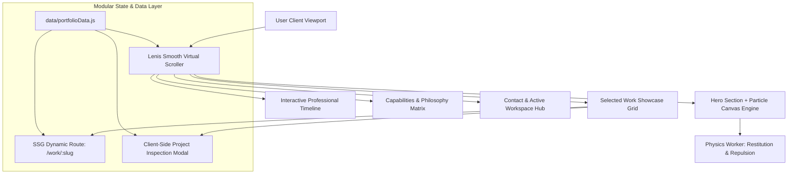

<div align="center">

# ✦ MD ALI AZGOR ✦
### *Futuristic Cinematic Portfolio & Interactive Digital Experience*

<br />

```
    ___    _____           ____  _______   __
   /   |  /__  /          / __ \/ ____/ | / /
  / /| |    / /  ______  / / / / __/ /  |/ / 
 / ___ |   / /__/_____/ / /_/ / /___/ /|  /  
/_/  |_|  /____/       /_____/_____/_/ |_/   
```

<br />

[](https://github.com/aliazgorLab)
[](https://linkedin.com/in/ali-azgor)
[](mailto:ali.azgor.0810@gmail.com)
[](https://maps.google.com/?q=22.3569,91.7832)

<br />

[](https://nextjs.org/)
[](https://react.dev/)
[](https://tailwindcss.com/)
[](https://greensock.com/)
[](https://github.com/darkroomengineering/lenis)
[](https://turbo.build/pack)
[](LICENSE)

<br />

[**Explore Highlights**](#-architectural-highlights) •
[**Featured Works**](#-featured-engineering-works) •
[**Career Trajectory**](#-career-trajectory--leadership) •
[**Physics Engine**](#-organic-particle-physics-engine) •
[**Tech Stack**](#-technology-stack) •
[**Getting Started**](#-getting-started) •
[**Connect**](#-author--connect)

</div>

---

## ✦ Executive Summary

Welcome to the personal portfolio codebase of **Md Ali Azgor** — an aspiring software engineer, creative developer, and UI/UX designer pursuing his B.Sc. in Computer Science & Engineering at **International Islamic University Chittagong (IIUC)**.

Currently serving as **Assistant General Secretary at IIUC Computer Club** and **CTO at Zahid's Chem Clinic**, Ali crafts high-performance digital products that merge cinematic visual art direction with resilient full-stack systems engineering.

This project was built from the ground up to challenge conventional portfolio templates, incorporating:
- **Custom Generative Canvas Particle Physics** with organic mouse-repulsion restitution.
- **Lenis + GSAP Inertia-Based Scroll Choreography**.
- **Dark Editorial Glassmorphism Aesthetics** (`#08090B` Obsidian, `#C7B8FF` Lavender, `#FF791F` Signature Orange).
- **Static Site Generation (SSG)** with pre-rendered dynamic project case studies (`/work/[slug]`).

---

## ⚡ Architectural Highlights



### 🌌 1. Organic Particle Portrait Disintegration
- **Alpha-Sampling Extraction**: The portrait is raster-sampled onto an offscreen canvas to filter non-transparent pixels into discrete particle entities.
- **Physics-Driven Restitution**: Each particle stores its original equilibrium coordinate `(originX, originY)` alongside velocity and acceleration vectors.
- **Force Field Calculations**: When the cursor enters proximity, an inverse-distance repulsion vector scatters particles into space. Upon cursor exit, Hooke's Law spring dynamics and velocity damping gently return every particle back into the crisp, coherent portrait.
- **Hardware Acceleration**: Built with batch canvas transforms to guarantee silky 60–120 FPS performance without CPU lockup.

### ✍️ 2. Handcrafted Signature Mark (`AZ.`)
- An expressive, handwritten personal mark rendered via precision SVG geometry.
- Employs a restrained `#FF791F` warm orange accent against the deep `#08090B` obsidian background, ensuring instant brand recognition.

### 🌊 3. Synchronized Kinetic Motion
- Virtualized inertia scrolling driven by `@studio-freight/lenis` (Lenis v1.3).
- Real-time scroll progress indicator and GPU-accelerated micro-interactions powered by GSAP 3.

### 🗂️ 4. Dual-Mode Project Exploration
- **Instant Drawer Modal**: Review project metrics, architecture highlights, and source links without breaking scroll context.
- **Dedicated Case Study Pages**: Fully optimized static pages (`app/work/[slug]/page.js`) generating clean SEO metadata and deep architectural deep dives.

---

## 💼 Career Trajectory & Leadership

```
2026 ───────▶  Assistant General Secretary · IIUC Computer Club       [CURRENT ROLE]
2025 ───────▶  Chief Technical Officer (CTO) · Zahid's Chem Clinic    [CURRENT ROLE]
2025 ───────▶  UI/UX Designer Intern · RACDOX                         [JAN — JUN 2025]
2024 ───────▶  Creative & Design Secretary · IIUC Computer Club       [OCT 2024 — 2025]
2023 ───────▶  Graphic Designer & Digital Specialist · ZCC Foundation [2023 — 2024]
```

| Organization | Role | Period | Scope & Impact |
| :--- | :--- | :--- | :--- |
| **IIUC Computer Club** | **Assistant General Secretary** | `2026 — PRESENT` | Co-directing executive club operations, flagship tech symposiums, national hackathons, and university developer culture. |
| **Zahid's Chem Clinic** | **CTO (Chief Technical Officer)** | `2025 — PRESENT` | Spearheading platform architecture, engineering team workflows, and digital educational web platform infrastructure. |
| **RACDOX** | **UI/UX Designer Intern** | `2025` | Delivered enterprise design systems, modular typography scales, responsive pattern libraries, and interactive prototypes. |
| **IIUC Computer Club** | **Creative & Design Secretary** | `2024 — 2025` | Spearheaded visual identity, tech festival stage aesthetics, digital branding campaigns, and student workshops. |
| **ZCC Foundation** | **Graphic Designer & Digital Platform Specialist** | `2023 — 2024` | Maintained digital learning portals, educational graphic collateral, and platform usability workflows. |

---

## 🚀 Featured Engineering Works

| Project | Category | Core Stack | Key Highlights | Workspace |
| :--- | :--- | :--- | :--- | :---: |
| **[IIUC Cover Page Generator](https://github.com/aliazgorLab/iiuc-cover-generator)** | Product Design & Frontend | `React` `Tailwind CSS` `jsPDF` `Canvas` | Automated academic layout synthesis suite generating print-ready deliverables; adopted by 5,000+ students. | [Inspect](https://github.com/aliazgorLab/iiuc-cover-generator) |
| **[OsMentor AI](https://github.com/aliazgorLab/osmentor-ai)** | AI / RAG Learning Platform | `React` `FastAPI` `LangChain` `ChromaDB` | Dual-pane technical learning assistant with vector node visualization and sub-400ms contextual embeddings. | [Inspect](https://github.com/aliazgorLab/osmentor-ai) |
| **[ProtocolZero](https://github.com/aliazgorLab/protocolzero)** | Real-Time Incident Escalation | `MERN` `Socket.IO` `Mapbox` `JWT` | Mission-critical security escalation suite with bidirectional WebSockets and sub-50ms alert dispatching. | [Inspect](https://github.com/aliazgorLab/protocolzero) |
| **[RACDOX Design System](https://github.com/aliazgorLab)** | Enterprise Design Architecture | `Figma` `Design Tokens` `UX Research` | Multi-tier tokenized design system spanning light, dark, and high-contrast modes with rapid developer handoff. | [Inspect](https://github.com/aliazgorLab) |
| **[DeadlockAI](https://github.com/aliazgorLab/deadlock-ai)** | Systems Simulation Suite | `Python` `Graph Algorithms` `Simulation` | Interactive concurrency modeling tool with live Resource Allocation Graph cycle detection and Banker's algorithm. | [Inspect](https://github.com/aliazgorLab/deadlock-ai) |

---

## 🛠️ Technology Stack

<div align="center">

| Domain | Technologies & Libraries |
| :--- | :--- |
| **Core Framework** | **Next.js 16.4** (App Router, Turbopack, React Server Components, SSG) |
| **UI Library** | **React 19.3** |
| **Styling Engine** | **Tailwind CSS 3.4**, Custom CSS Keyframes, CSS Glassmorphism |
| **Motion & Animation** | **GSAP 3.15** (ScrollTrigger, TweenLite), **Lenis v1.3** Virtual Smooth Scroll |
| **Graphics & Compute** | **HTML5 Canvas 2D**, Offscreen pixel rasterization, Vector physics |
| **Iconography** | **Lucide React** |
| **Typography** | `Space Grotesk`, `Syne`, `Inter`, `JetBrains Mono` |
| **Tooling & Build** | Turbopack, PostCSS, Autoprefixer, ESLint |

</div>

---

## 📁 Repository Directory Structure

```text
my-portfolio/
├── app/
│   ├── layout.js              # Global HTML document, fonts, and meta headers
│   ├── page.js                # Core landing page orchestrating all sections
│   ├── globals.css            # Base stylesheet, custom tokens, and glass utilities
│   └── work/
│       └── [slug]/
│           └── page.js        # Dynamic SSG project case study layout
├── components/
│   ├── layout/
│   │   ├── Navbar.jsx         # Sticky glass navigation with handwritten AZ. logo
│   │   ├── Footer.jsx         # Minimalist closing section with return-to-top hook
│   │   ├── SmoothScroll.jsx   # Lenis continuous scroll synchronization
│   │   ├── ScrollProgress.jsx # Fixed top scroll progress tracker
│   │   └── Preloader.jsx      # Initial cinematic bootloader sequence
│   ├── sections/
│   │   ├── Hero.jsx           # Editorial hero header and particle canvas host
│   │   ├── Statement.jsx      # Kinetic typographic ethos banner
│   │   ├── SelectedWork.jsx   # Curated project showcase with responsive cards
│   │   ├── About.jsx          # Personal background, philosophy, and education
│   │   ├── Philosophy.jsx     # Guiding software and design tenets
│   │   ├── Experience.jsx     # Chronological career trajectory roadmap
│   │   ├── Capabilities.jsx   # Technical competencies and toolchain matrix
│   │   └── Contact.jsx        # Communication hub with active workspace pipes
│   └── ui/
│       ├── AZSignature.jsx    # Handcrafted SVG vector logo component
│       ├── ParticlePortrait.jsx # Generative canvas particle disintegration engine
│       ├── ProjectModal.jsx   # Overlay modal for swift project inspection
│       └── Icons.jsx          # Bespoke SVG brand and workspace icons
├── data/
│   └── portfolioData.js       # Single source of truth (Bio, Works, Timeline, Skills)
├── public/
│   └── images/                # Transparent hero portrait asset & project screenshots
├── tailwind.config.js         # Theme extensions, palettes, and typography tokens
├── next.config.mjs            # Next.js build and optimization options
└── package.json               # Manifest file with scripts and dependencies
```

---

## ⚡ Getting Started Locally

### Prerequisites
- [Node.js](https://nodejs.org/) (Version **18.18+** or **20+** recommended)
- [npm](https://www.npmjs.com/) (Version **9+**) or [pnpm](https://pnpm.io/)

### Quickstart

1. **Clone the repository:**
   ```bash
   git clone https://github.com/aliazgorLab/my-portfolio.git
   cd my-portfolio
   ```

2. **Install project dependencies:**
   ```bash
   npm install
   ```

3. **Start the local development server:**
   ```bash
   npm run dev
   ```

4. **Access the application:**
   Open your browser and navigate to `http://localhost:3000`.

---

## 🔧 Production Build & Optimization

To test the optimized production build locally:

```bash
# Generate the production bundle with static page pre-rendering
npm run build

# Start the Next.js production server
npm run start
```

### Static Generation Matrix:
- `/` — Static Pre-rendered Landing Experience
- `/_not-found` — Static 404 Experience
- `/work/iiuc-cover-generator` — Pre-rendered Case Study
- `/work/osmentor-ai` — Pre-rendered Case Study
- `/work/protocolzero` — Pre-rendered Case Study
- `/work/racdox-design` — Pre-rendered Case Study
- `/work/deadlock-ai` — Pre-rendered Case Study

---

## ⚙️ Modular Data Management

All biographical details, portfolio projects, career positions, and skill tags are decoupled from UI logic and stored in [`data/portfolioData.js`](data/portfolioData.js).

```javascript
// Example: Modifying the personal profile & links
export const personalInfo = {
  name: "Md Ali Azgor",
  title: "UI/UX DESIGNER · CREATIVE DEVELOPER · SOFTWARE ENGINEERING STUDENT",
  email: "ali.azgor.0810@gmail.com",
  linkedin: "https://linkedin.com/in/ali-azgor",
  github: "https://github.com/aliazgorLab",
  location: "CHITTAGONG, BANGLADESH",
  // ...
};
```

---

## 🚀 Deployment

The portfolio is architected for zero-configuration deployment on **[Vercel](https://vercel.com/)**:

[](https://vercel.com/new/clone?repository-url=https%3A%2F%2Fgithub.com%2FaliazgorLab%2Fmy-portfolio)

1. Connect your GitHub account and import `aliazgorLab/my-portfolio`.
2. Vercel automatically detects the Next.js preset.
3. Deploy directly to the global edge network.

---

## 👤 Author & Connect

**Md Ali Azgor**
*Creative Developer · UI/UX Designer · Software Engineering Student*

- 🌐 **GitHub**: [@aliazgorLab](https://github.com/aliazgorLab)
- 💼 **LinkedIn**: [ali-azgor](https://linkedin.com/in/ali-azgor)
- 📧 **Direct Inquiries**: [ali.azgor.0810@gmail.com](mailto:ali.azgor.0810@gmail.com)
- 📍 **Location**: Chittagong, Bangladesh (`22.3569° N, 91.7832° E`)
- 🎓 **Education**: B.Sc. in Computer Science & Engineering, International Islamic University Chittagong

---

## 📄 License

This repository is licensed under the [ISC License](LICENSE) © 2025–2026 Md Ali Azgor.

<div align="center">
  <sub>Engineered with precision, dark aesthetics, and attention to every frame.</sub>
</div>
# MyPortfolio
